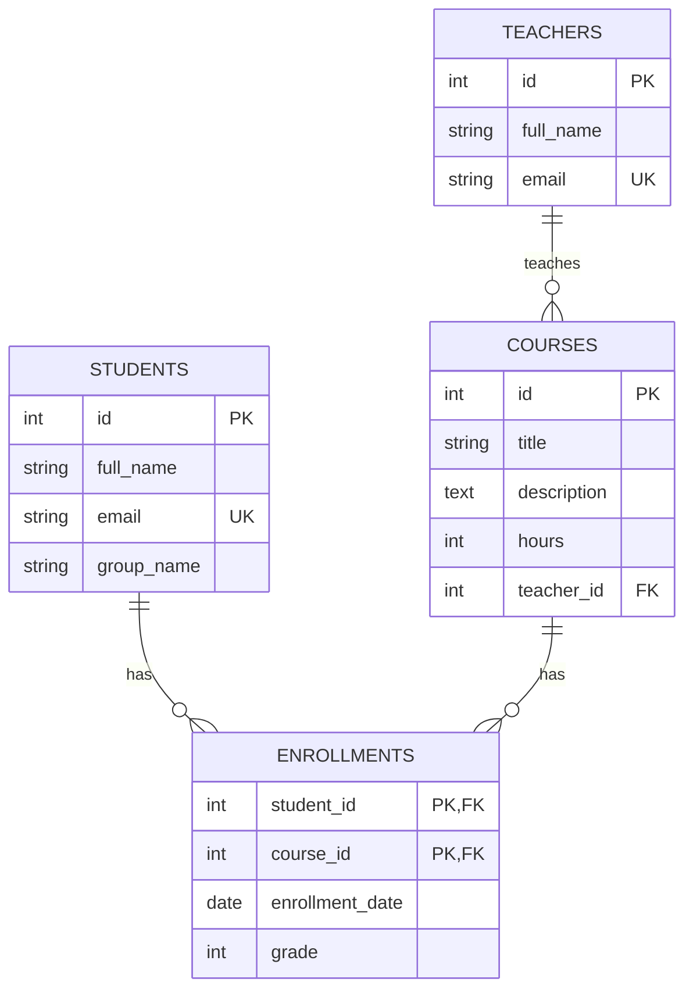

# Лабораторная работа: реляционные БД, PostgreSQL, ORM, API

**Тема:** проектирование схемы БД, SQL, PostgreSQL, ORM (Sequelize), REST API  
**Предметная область:** Учебный центр

## ER-диаграмма



## Почему схема в 3НФ

Каждая таблица описывает одну сущность (преподаватель, курс, студент, запись). Нет транзитивных зависимостей — оценка зависит только от пары «студент + курс», а не от ФИО или названия курса. Все атрибуты атомарны, повторяющихся групп нет. Связь «многие ко многим» вынесена в отдельную таблицу `enrollments` с составным первичным ключом.

## Структура проекта

```
lab-db/
├── sql/
│   ├── schema.sql      # CREATE TABLE + ограничения
│   ├── seed.sql        # тестовые данные
│   └── queries.sql     # все требуемые запросы
├── src/
│   ├── db.js           # Sequelize-модели и связи
│   ├── test.js         # проверка ORM
│   └── server.js       # REST API
├── .env.example
├── .gitignore
├── package.json
└── README.md
```

## Как запустить

### 1. База данных (Neon)

1. Создайте проект на [neon.tech](https://neon.tech).
2. В SQL Editor выполните сначала `sql/schema.sql`, затем `sql/seed.sql`.
3. Скопируйте Connection string.

### 2. Codespaces / локально

```bash
npm install
cp .env.example .env
# вставьте свою DATABASE_URL в .env
```

### 3. Проверка ORM

```bash
node src/test.js
```

### 4. Запуск API

```bash
node src/server.js
```

Порт 3000. В Codespaces откройте вкладку **Ports**.

### Примеры curl

```bash
# Список курсов с преподавателями
curl http://localhost:3000/courses

# Один курс
curl http://localhost:3000/courses/1

# Создать курс
curl -X POST http://localhost:3000/courses \
  -H "Content-Type: application/json" \
  -d '{"title":"Новый курс","description":"Описание","hours":32,"teacherId":1}'

# Обновить курс
curl -X PUT http://localhost:3000/courses/1 \
  -H "Content-Type: application/json" \
  -d '{"title":"Обновлённое название","hours":45}'

# Удалить курс
curl -X DELETE http://localhost:3000/courses/5

# Записать студента на курс
curl -X POST http://localhost:3000/enrollments \
  -H "Content-Type: application/json" \
  -d '{"studentId":1,"courseId":5,"grade":88}'

# Курсы студента
curl http://localhost:3000/students/1/courses
```

## Критерии выполнения

| Часть              | Баллы |
|--------------------|-------|
| Проектирование + ER| 20    |
| SQL (schema + seed + queries) | 30 |
| ORM (модели + test.js) | 20 |
| REST API           | 20    |
| Бонус (INDEX + EXPLAIN) | +5 |
